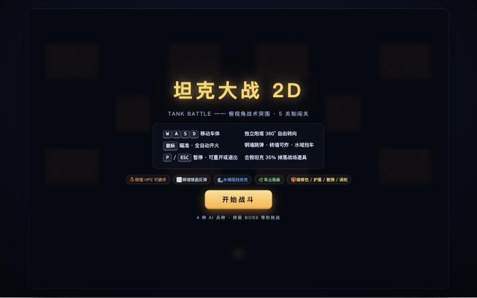
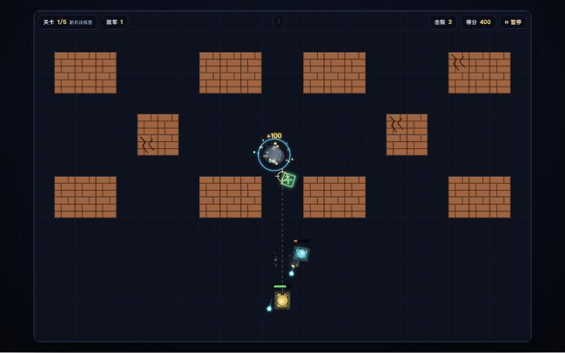

# 坦克大战 2D · Tank Battle

纯 HTML5 Canvas 打造的 2D 俯视角坦克闯关游戏。单文件、零外部依赖，所有图形均由 Canvas 程序化绘制。

**在线试玩**：https://tankplay.vercel.app

## 运行截图

| 主菜单 | 游戏画面 |
| :---: | :---: |
|  |  |

## 玩法

- **W A S D**：移动车体
- **鼠标**：360° 瞄准，自动开火
- **P / ESC**：暂停 / 重开或退出
- 钢墙镜面反弹、砖墙（HP 2）可被击毁、水域阻挡坦克、草丛隐蔽
- 击毁敌方坦克有 35% 概率掉落道具：维修包 / 护盾 / 散弹 / 涡轮
- 5 关制闯关，4 种 AI 兵种，终关有重装 BOSS

## 运行方式

无需构建，直接用浏览器打开 `index.html` 即可；或在目录下执行：

```bash
python3 -m http.server 8000
```

然后访问 http://localhost:8000。

## 文件说明

- `index.html`：游戏全部代码
- `2d_web_ai.md`：AI 开发规范文档（PRD & Tech Spec）
- `screenshots/`：README 运行截图
